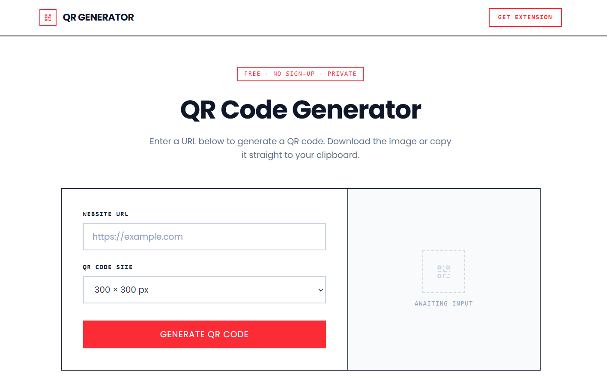
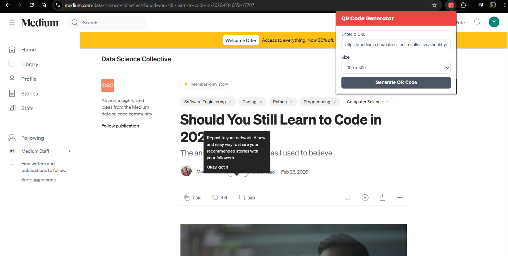
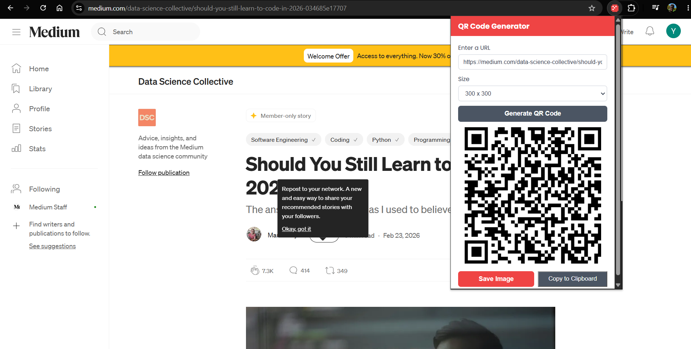
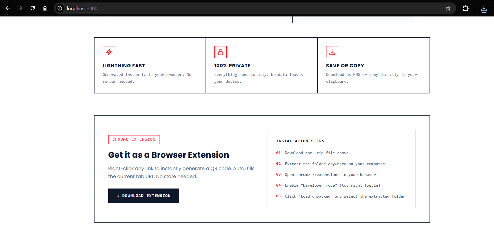
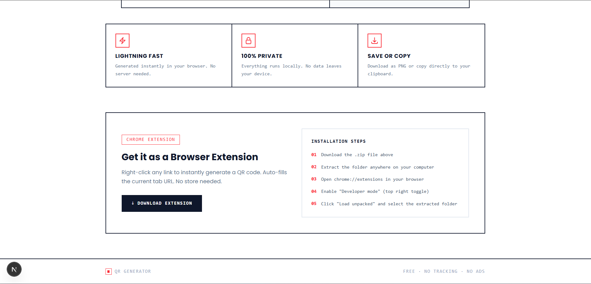
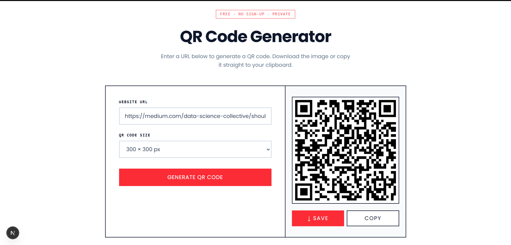
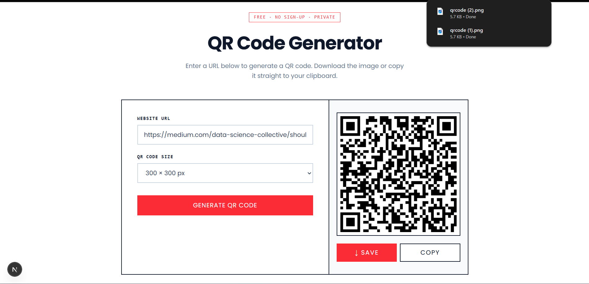

# QR Code Generator

Free, open-source QR code generator available as a **web app** and **Chrome extension**. Generate, download, and share QR codes instantly — no sign-up, no tracking.

## Screenshots

### Web App

| Landing Page | QR Generated |
|:---:|:---:|
|  |  |

| Copy to Clipboard | Features Section |
|:---:|:---:|
|  |  |

| Extension Install | Footer |
|:---:|:---:|
|  |  |

### Chrome Extension

| Popup | Context Menu |
|:---:|:---:|
|  | |

## Features

- **Instant QR generation** — runs entirely in your browser, no server needed
- **Download as PNG** — save QR codes in various sizes (100–700px)
- **Copy to clipboard** — one click to paste into any app
- **100% private** — no data ever leaves your device
- **Chrome extension** — right-click any link to generate a QR code instantly
- **Free forever** — no ads, no sign-up, no tracking

## Web App

### Tech Stack

- [Next.js](https://nextjs.org/) 16
- [React](https://react.dev/) 18
- [TypeScript](https://www.typescriptlang.org/)
- [Tailwind CSS](https://tailwindcss.com/) v4
- [qr-creator](https://github.com/nimiq/qr-creator) (browser-native QR rendering)

### Getting Started

```bash
# Install dependencies
npm install

# Start development server
npm run dev

# Build for production
npm run build

# Start production server
npm run start
```

Open [http://localhost:3000](http://localhost:3000) to see the app.

### Project Structure

```
├── app/
│   ├── globals.css       # Tailwind v4 styles
│   ├── layout.tsx        # Root layout with Poppins font
│   └── page.tsx          # Main QR generator page
├── public/
│   ├── favicon.svg       # SVG favicon
│   ├── img/              # Static images
│   └── qr-code-extension.zip  # Downloadable Chrome extension
└── scripts/
    └── build-extension.js  # Packages extension into ZIP
```

## Chrome Extension

### Features

- **Popup UI** — compact popup to generate QR codes on demand
- **Auto-fill** — automatically grabs the current tab's URL
- **Right-click menu** — generate a QR code for any link by right-clicking it
- **Save & Copy** — download as PNG or copy to clipboard with visual feedback

### Install from Website

1. Click **"Get Extension"** in the navbar or scroll to the install section
2. Download the `.zip` file
3. Extract the folder anywhere on your computer
4. Open `chrome://extensions` in your browser
5. Enable **Developer mode** (top right toggle)
6. Click **"Load unpacked"** and select the extracted folder

### Install from Source

```bash
# Package the extension
npm run build:ext

# The ZIP will be at public/qr-code-extension.zip
# Follow steps 3-6 above using the chrome-extension/ folder
```

### Project Structure

```
chrome-extension/
├── manifest.json         # Manifest V3 config
├── background.js         # Service worker (context menus)
├── popup.html            # Popup UI
├── popup.css             # Popup styles
├── popup.js              # QR generation + clipboard logic
├── qr-creator.min.js     # Bundled QR library
└── icons/
    ├── icon16.png
    ├── icon48.png
    └── icon128.png
```

## Distribution

### Web App

Deploy to any static host (Vercel, Netlify, Cloudflare Pages, etc.):

```bash
npm run build:ext   # Package extension ZIP into public/
npm run build        # Build Next.js app
```

The extension ZIP is served from `/qr-code-extension.zip` for free direct download — no Chrome Web Store fees required.

### Chrome Web Store (Optional)

If you want to publish to the Chrome Web Store ($5 one-time fee):

1. Go to the [Chrome Web Store Developer Dashboard](https://chrome.google.com/webstore/devconsole)
2. Click **"New Item"** and upload the extension ZIP
3. Fill in the listing details and submit for review
4. Updates: bump `version` in `manifest.json`, repackage, and upload as a new version

## License

MIT
